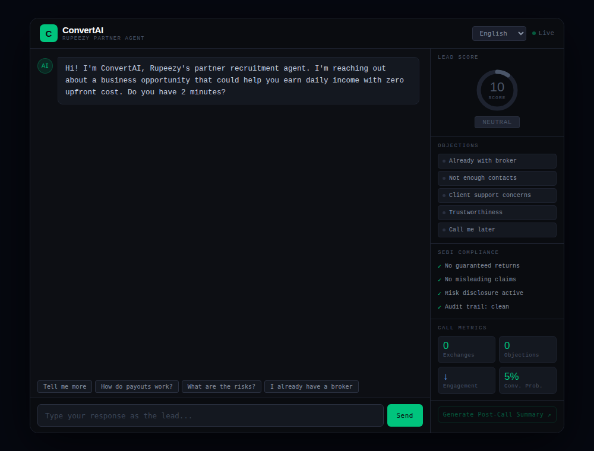
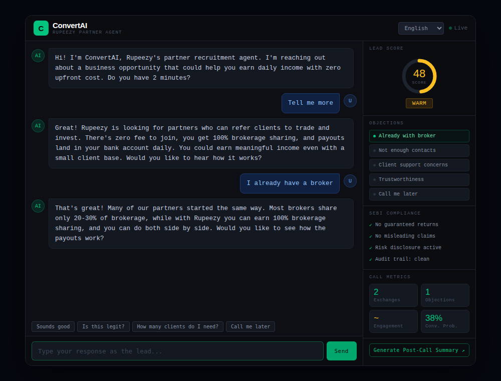
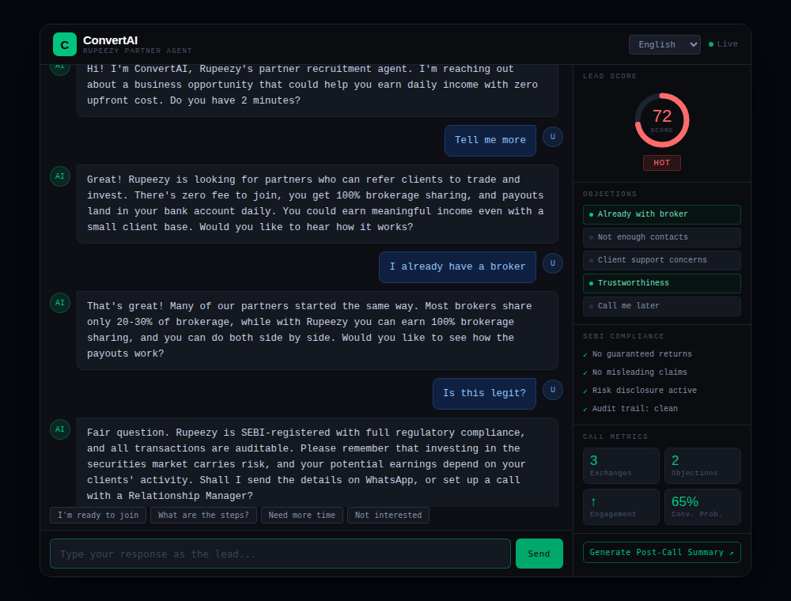
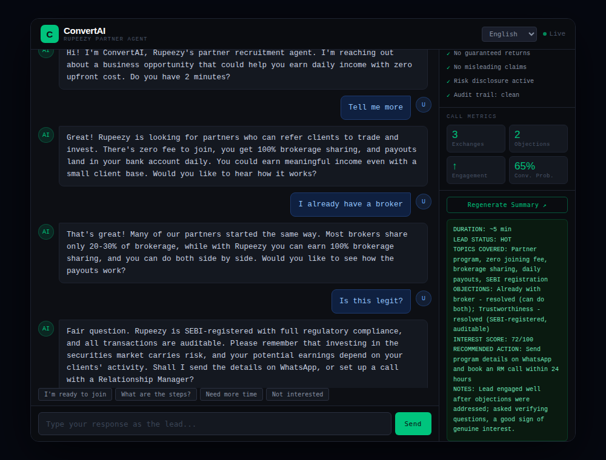

# ConvertAI — Rupeezy Partner Recruitment Agent

ConvertAI is an AI sales-agent demo that converses with leads (prospective sub-brokers) and tries to convert them into Rupeezy partners. While the conversation runs, a live dashboard scores the lead, tracks objections, checks SEBI-compliance rules, and can produce a post-call summary for the relationship manager.

Built for the **AI for Bharat** hackathon. The whole app is a single static file: `convertai.html`.

## Features

- **Scripted sales flow**: Hook → Benefits → Objection handling → Call to action, driven by a system prompt.
- **Multilingual**: English, Hindi, and Hinglish, selectable from the header dropdown.
- **Live lead scoring**: a 0–100 score with a Hot / Warm / Cold tag, updated after every reply.
- **Objection tracker**: detects and marks as handled the five core objections:
  - Already with a broker
  - Not enough contacts
  - Client support concerns
  - Trustworthiness
  - "Call me later"
- **SEBI compliance panel**: the agent is instructed never to promise guaranteed returns or make misleading earnings claims, and can raise a compliance flag in the UI.
- **Call metrics**: exchanges, objections, engagement level, and conversion probability.
- **Quick-reply buttons**: context-aware suggestions that change with the agent's last message.
- **Post-call summary**: generates duration, lead status, topics covered, objection resolutions, recommended next action, and notes.

## Screenshots

> UI preview using a simulated conversation (scripted replies), to show the layout and dashboard. Real model output will vary.

| Start | Objection handling |
| --- | --- |
|  |  |

| Hot lead + SEBI compliance panel | Post-call summary |
| --- | --- |
|  |  |

## Results

Results from running the agent are available in the [`results/`](results/) folder.

## How it works

1. The browser sends the conversation history plus a system prompt to the Groq chat completions API (OpenAI-compatible) using the `openai/gpt-oss-120b` model.
2. The system prompt tells the model to end every reply with a machine-readable block:
   ```
   [ANALYTICS:{"score":0-100,"tag":"hot|warm|cold|neutral","objDetected":[],"objHandled":[],"engagement":"low|medium|high","convProb":"X%","complianceFlag":false}]
   ```
3. The UI parses that block (`parseAnalytics`), strips it from the visible message (`cleanText`), and updates the score ring, objection list, metrics, and compliance panel.

There is no backend and no build step. Everything runs in the browser.

## Getting started

### Prerequisites

- A modern browser
- A free [Groq API key](https://console.groq.com/keys)
- Optional: Python 3 or Node.js to serve the file locally

### Run it

```bash
git clone https://github.com/bhavana-sreenivasan/convertAI
cd convertAI
```

Serve the file locally:

```bash
python -m http.server 8000
# open http://localhost:8000/convertai.html
```

On first load the app asks for your Groq API key and stores it in your browser's `localStorage` (it is never written to the code or the repo). To clear it, run `localStorage.removeItem("groq_key")` in the browser console.

The endpoint and model are set in the config block at the top of the `<script>`:

```js
const API_URL = "https://api.groq.com/openai/v1/chat/completions";
const MODEL   = "openai/gpt-oss-120b";
```

## Usage

1. Pick a language in the top-right dropdown.
2. Reply to the agent by typing, or use the quick-reply buttons. Try raising objections like *"I already have a broker"* or *"Is this legit?"*.
3. Watch the right-hand panel update: lead score, objection status, compliance checks, and metrics.
4. Click **Generate Post-Call Summary** to get a hand-off note.

## Configuration

| Setting | Where | Purpose |
| --- | --- | --- |
| `API_KEY` | browser prompt (`localStorage`) | Groq API key, entered on first load |
| `MODEL` | top of `<script>` | Any chat model available on Groq |
| `SYSTEM_TEMPLATE` | top of `<script>` | Sales script, objection responses, compliance rules |
| `{LANG}` | `systemPrompt()` | Replaced with English, Hindi, or Hinglish |

To adapt the agent to another product, edit `SYSTEM_TEMPLATE` (benefits, objection responses) and the objection list in the HTML.

## Security note

This is a demo. The key you enter is stored in your own browser and sent only to Groq, but anything in client-side JavaScript can be read by the person using that browser. **Never commit a real key to a public repository.** For anything beyond a demo, route requests through a small backend or serverless function that holds the key and forwards calls to Groq.

## Limitations

- Lead scores and "SEBI compliance" are produced by the LLM following a prompt. They are not a substitute for a real compliance review or audit trail.
- The agent is text-only. Voice input and output are not implemented.
- Conversation history lives in memory and is lost on refresh.
- Analytics depend on the model returning valid JSON; if it doesn't, the dashboard simply doesn't update for that turn.

## Tech stack

HTML, CSS, vanilla JavaScript · Groq API (GPT-OSS 120B) · Google Fonts (Syne, DM Mono)

## Disclaimer

This project is a hackathon prototype and is not an official Rupeezy product. Investing in the securities market carries risk, and nothing generated by the agent should be treated as a guarantee of earnings.
